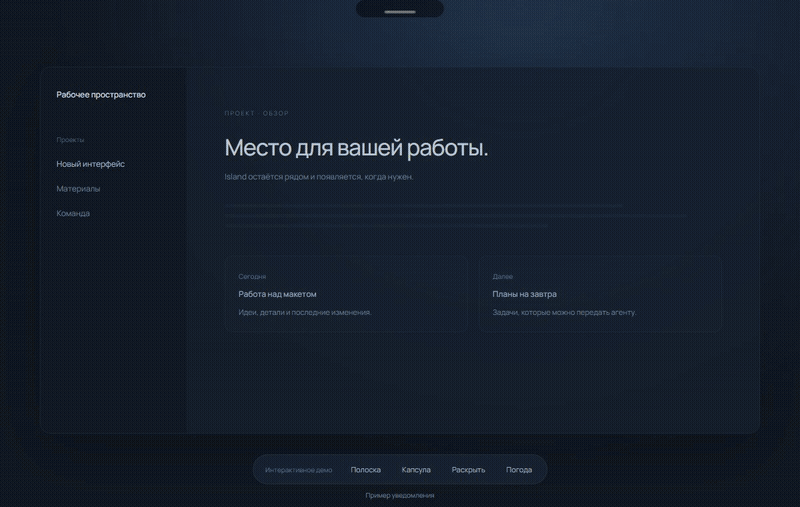
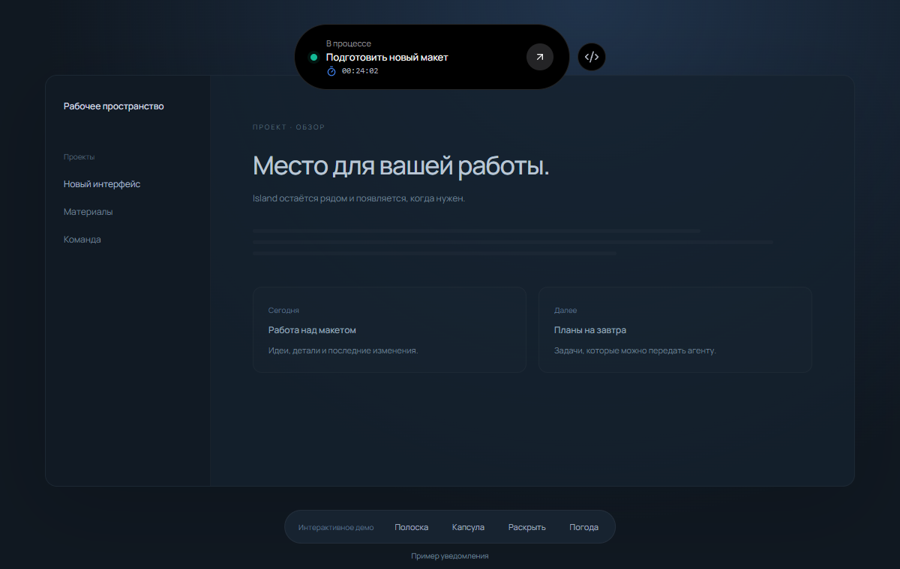
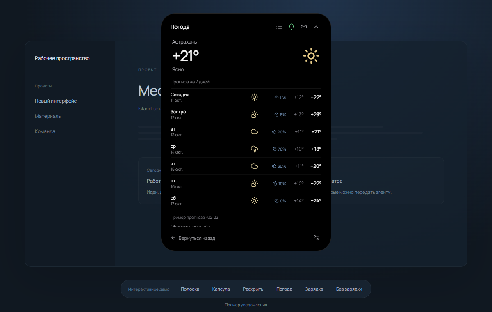
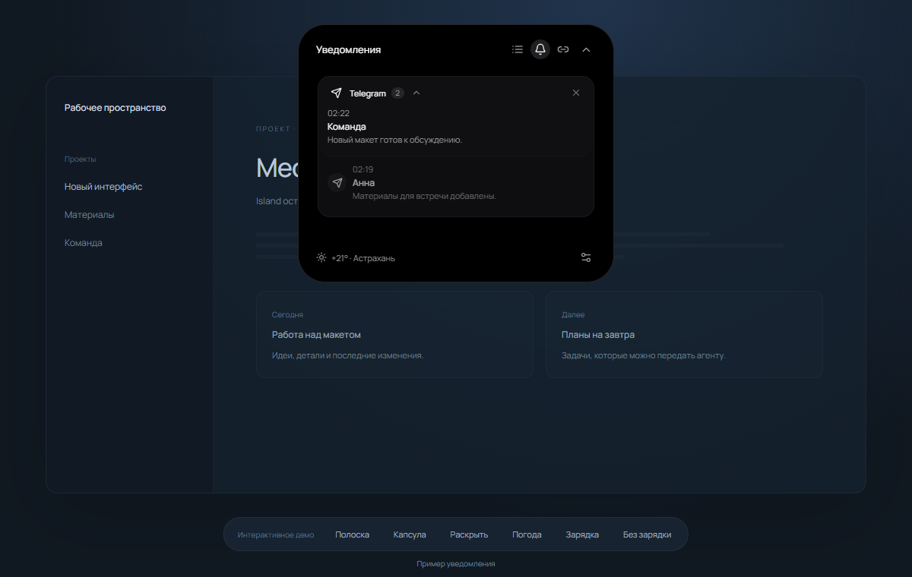
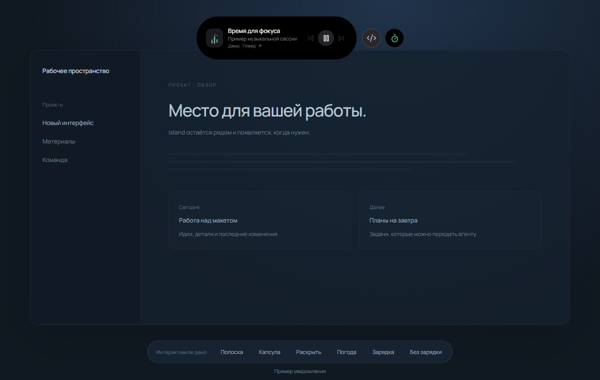
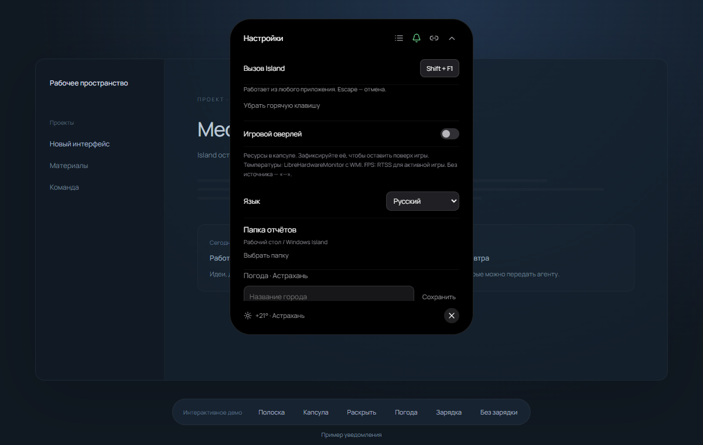
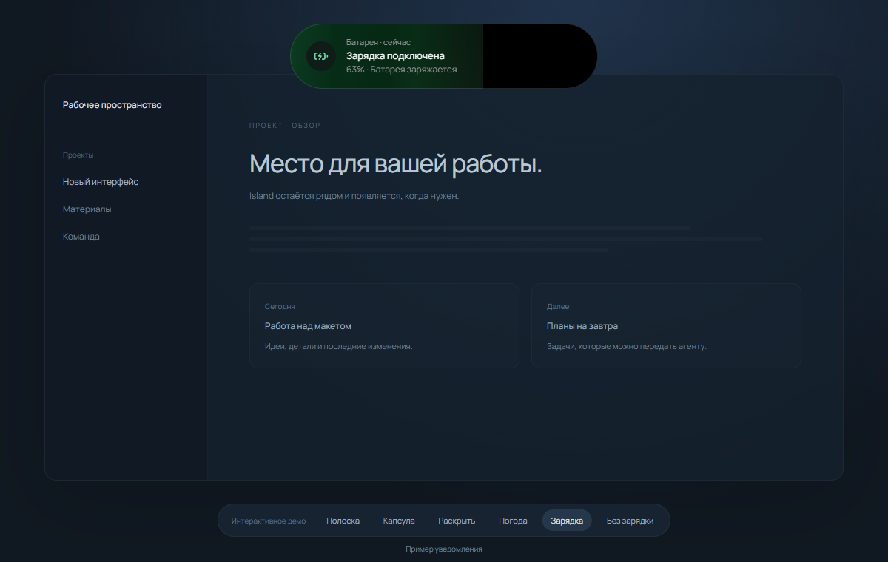

# Windows Island

**Dynamic Island для Windows**: тихая полоска, уведомления, задачи, таймер фокуса, календарь и погода. MCP для Codex, Claude и других ИИ-агентов.

[Скачать для Windows](https://github.com/kotashovv/windows-island/releases/latest) · [Интерактивное демо](https://kotashovv.github.io/windows-island/demo/?demo=1) · [Сайт](https://kotashovv.github.io/windows-island/)



Демонстрация интерфейса на вымышленных задачах. Показатели ресурсов в браузерном демо синтетические; Windows-приложение читает только реальные доступные метрики. Прогноз в браузерном демо — пример; Windows-приложение получает реальные данные Open-Meteo.

## Статус реализации

Актуальная версия: `release/Windows-Island-0.3.3.exe`. Она содержит миниатюрную активную полоску, капсулу с таймером, анимации задач, прогноз на 7 дней, обновления с GitHub и 15 MCP-инструментов. Старый `Windows-Island-0.1.0.exe` сохранён отдельно и содержит прежний интерфейс: запускайте файл 0.3.3.

В 0.3 добавлены батарея, зарядка, подключение Wi-Fi, системное управление музыкой, стопки уведомлений по приложениям и Telegram. Календарь скрыт из интерфейса; события и MCP-инструменты сохранены.

В 0.3.2 погода оставлена только внизу. Wi-Fi и батарея показываются на 3 секунды без записи в историю; старые системные сообщения тоже скрыты из списка. Отдельные круглые капсулы справа переключают уведомление, музыку и активную задачу с плавным перетеканием. В настройках шестерёнка становится крестиком для возврата к задачам. Нотисы перехода к музыкальному источнику белые и исчезают через 3 секунды. Ctrl+W, Alt+F4 и закрытие окна сворачивают Island, сохраняя работу таймера и MCP. Полностью выйти можно через «Выйти» в трее или правый клик на капсуле → «Отключить».

Модульные проверки и smoke-тест настоящего Electron проверяют таймер, жест с возвратом без отпускания мыши, MCP, повторную доставку отчётов, импорт .ics и создание отчёта на рабочем столе. Совместимость приёма уведомлений Windows зависит от локальной базы уведомлений и настроек источника; состояние подключения видно в настройках Island.

## Дизайн и управление 0.2

Один монолитный элемент меняет форму, положение и содержимое. Состояния:

- **Мини, покой:** язычок 132 × 26 логических пикселей; из-за верхнего края видны только 14 пикселей высоты. Чёрная поверхность с непрозрачностью 42%, ручка приглушена. При наведении поверхность плавно становится плотнее (96%), ручка ярче; после ухода указателя прозрачность возвращается. При наведении серая ручка плавно увеличивается и светлеет; сама капсула остаётся на месте.
- **Мини, в работе:** тот же язычок 132 × 26. Меняется только цвет ручки: зелёный во время задачи, серый в покое. Название и таймер скрыты. Сворачивание не останавливает трекинг.
- **Капсула:** показывает выбранное уведомление, музыку или задачу с таймером. Остальные доступные состояния представлены кружками справа: нажатие плавно меняет содержимое, предыдущая карточка становится кружком. Новое обычное уведомление выбирается первым; запуск задачи выбирает таймер. Музыка и трекинг продолжаются при переключении. Название трека/задачи раскрывает полное окно. Капсула, уведомление и раскрытое окно имеют тонкую светлую внутреннюю границу.
- **Уведомление:** значок приложения слева, заголовок и текст, кнопка «Перейти». После 3–5 секунд возврат в серую или зелёную мини-полоску, в зависимости от текущей задачи.
- **Раскрытое:** задачи, уведомления, соединения, настройки и погода. Иконки — список, колокольчик и ссылка. Заголовок соответствует вкладке, смена вкладок сопровождается движением содержимого. Внизу доступна погода, если функция включена; отчёт дня находится в настройках и меню трея. Календарь пока скрыт.

Перетягивание следует за указателем без задержки и размытия: можно пройти через уведомление до полного раскрытия и вернуться обратно, не отпуская мышь. Порог не фиксирует состояние во время жеста. После отпускания — мягкая фиксация в ближайшем состоянии. Обычный клик открывает капсулу, следующее нажатие раскрывает её полностью, с пружинным bounce и кратким размытием, пропорциональным скорости движения. Размытие исчезает после остановки; reduced-motion отключает пружину и blur. В полноэкранном режиме капсула скрыта, таймер и сохранение уведомлений продолжаются.

## Настройки 0.3.2

В настройках доступны русский и английский языки и выбор папки отчётов. Язык меняет интерфейс, меню трея и заголовки отчёта; текст ваших задач и сообщений сохраняется. Папка по умолчанию — `Рабочий стол/Windows Island`. Можно выбрать другую папку или вернуть значение по умолчанию.

Переключатель **«Задачи и учёт времени»** скрывает вкладку задач и зелёный индикатор. Активный таймер ставится на паузу с сохранением времени; задачи не удаляются. Для возвращения списка включите переключатель. Погоду, управление музыкой, уведомления батареи, Wi-Fi и VPN можно отключать отдельно. Отключённые модули перестают опрашиваться в фоне.

Подключение зарядки показывает мягкий зелёный фон, заполняющий капсулу до текущего процента батареи, с волнами слева направо. При отключении красное заполнение уменьшается справа налево. Эффекты длятся только во время короткого уведомления и учитывают настройку Windows «уменьшить движение». VPN, зарядка и Wi-Fi показываются на 3 секунды и не попадают в историю. VPN определяется по активным сетевым адаптерам Windows; приложения, работающие только как прокси без VPN-адаптера, могут не определяться.

В прогнозе кнопка погоды превращается в **«Вернуться назад»** и возвращает предыдущую вкладку.

В Windows-сборку не входит интерактивное демо или его браузерное хранилище. Демо для сайта собирается отдельной командой `npm run build:demo`. Музыка читается нативным мостом без отдельного PowerShell-процесса; закрытый список задач не держится в DOM, а таймер интерфейса обновляется только при просмотре. Для проверки расхода памяти см. [docs/performance.md](docs/performance.md).

## Горячая клавиша, тачпад и игровой оверлей 0.3.3

В настройках **«Вызов Island»** нажмите комбинацию: по умолчанию `Shift+F1`. Она раскрывает Island из другого приложения; повторное нажатие сворачивает. Можно убрать назначение. Комбинация сохраняется между запусками; если она занята, прежняя остаётся активной. Escape отменяет запись. Alt+F4 и Ctrl+W по-прежнему только сворачивают.

В раскрытом Island горизонтальное движение двумя пальцами по тачпаду переключает **Задачи ↔ Уведомления** с существующей анимацией. Вертикальная прокрутка сохраняется; жесты над полями ввода и масштабирование Ctrl+прокрутка не перехватываются. При отключённых задачах переключение недоступно.

Включите **«Игровой оверлей»** в настройках. Шесть кругов показывают температуры CPU/GPU, FPS, RAM в GB и загрузку CPU/GPU. Ресурсы доступны в активной капсуле и полном окне; мини-полоска сохраняет прежний размер. Кнопка **«Зафиксировать»** удерживает активную капсулу, даже когда фокус переходит в другое приложение. Фон становится прозрачным до наведения; значения продолжают обновляться. **«Открепить»** возвращает обычное поведение. Закрепление не сохраняется после перезапуска. Короткие уведомления временно заменяют ресурсы и возвращаются к закреплённой капсуле.

По умолчанию Island скрыт в полноэкранных приложениях. Исключение — пользователь явно включил игровой оверлей и закрепил капсулу. Это обычное окно поверх других окон: режим игры «в окне без рамки» поддерживается; поверх эксклюзивного полноэкранного вывода отображение не гарантируется. Внедрения в игру нет.

Источники реальных метрик:

- CPU и RAM: `GetSystemTimes` и `GlobalMemoryStatusEx` Windows.
- GPU: языконезависимые счётчики PDH `GPU Engine`, сумма процессов по каждому физическому движку, максимум по движкам/адаптерам. Недоступные счётчики показывают «—».
- Температуры: запущенный [LibreHardwareMonitor](https://github.com/LibreHardwareMonitor/LibreHardwareMonitor) или OpenHardwareMonitor, через WMI `Sensor`. Island не устанавливает драйверы и не запускает монитор самостоятельно. Если датчики недоступны, отображается «—»; температура ACPI-зоны не выдаётся за температуру CPU.
- FPS: запущенный RivaTuner Statistics Server (RTSS) с обнаружением активной игры, через **чтение** `RTSSSharedMemoryV2`. Показывается частота кадров выбранного внешнего приложения; пока Island в фокусе, сохраняется последняя внешняя цель. Устаревшие данные скрываются. Частота обновления монитора и FPS самого интерфейса не используются.

Данные не записываются в историю и отчёты. Опрос выполняется в существующем нативном мосте раз в 2 секунды только при включённом оверлее и видимой капсуле. Температуры читаются раз в 5 секунд, при отсутствии провайдера повторная попытка — через 30 секунд. При закрытии капсулы или отключении функции опрос останавливается, PDH-запрос освобождается.

## Запуск

Готовое приложение: `release/Windows-Island-0.3.3.exe`. Двойной щелчок запускает переносимую версию. Для раскрытия нажмите на полоску в центре верхнего края экрана или потяните вниз. Меню в системном трее позволяет открыть приложение, создать отчёт и выйти. Пользовательские задачи и настройки остаются в прежнем профиле `%APPDATA%/windows-island`.

Из исходников, с установленным Node.js 22.12+:

```powershell
npm ci
npm run build
npm start
```

Разработка: `npm run dev`. Предпросмотр дизайна в браузере: `npm run dev:web`. Сборка переносимого Windows exe: `npm run dist`.

## Поведение

- Размер служебного прозрачного окна остаётся постоянным при смене состояний, чтобы Windows не пересоздавала поверхность во время анимации. Меняется только сама капсула. Пустая область и скруглённые углы пропускают клики к приложениям под ними; захват мыши сохраняется на время перетягивания. Используется [Electron setIgnoreMouseEvents](https://www.electronjs.org/docs/latest/tutorial/custom-window-interactions#click-through-windows).
- Нажатие раскрывает компактную чёрную капсулу. Кнопка сворачивания, Escape или переход в другое окно сворачивает её. Настройки анимации учитывают `prefers-reduced-motion`; содержимое длинных списков прокручивается внутри капсулы.
- Уведомления от Island и MCP появляются на 4 секунды. Во время работы с раскрытой капсулой сообщение сохраняется и показывается внутри неё. «Не беспокоить» подавляет всплывание, сохраняя историю.
- Инверсия по фону отключена; снимки экрана для определения яркости больше не делаются.
- Завершённая задача сначала показывает анимированную галочку и плавно уезжает вправо. Данные сохраняются сразу; это работает и для завершения через MCP. Детали задачи раскрываются и сворачиваются плавно, с мягкой пружиной.
- Запуск задачи включает таймер; одновременно активна одна задача. Пауза и завершение сохраняют рабочие сессии. Произвольные команды, код или ИИ-агенты этим действием не запускаются.
- Отчёт дня сохраняется в выбранной папке; по умолчанию — `Рабочий стол/Windows Island/Отчёт-YYYY-MM-DD-*.md`. Для английского языка имя начинается с `Report-`. Время считается только в пределах выбранного дня, в том числе для сессий через полночь. Создание отчёта не завершает текущую задачу.
- Календарь принимает события вручную, через MCP или из `.ics`. Импорт охватывает ближайшие 90 дней, поддерживает повторы, исключения и часовые пояса; повторный импорт не дублирует одинаковые события. Разворачивание повторов ограничено 10 000 вхождениями на серию. За 5 минут до события появляется напоминание, если приложение запущено.
- Погода: Open-Meteo, обновление каждые 30 минут. Нажатие на значок погоды открывает прогноз на 7 дней: температура днём и ночью, условия и вероятность осадков. При ошибке обновления остаётся прежний прогноз с явным сообщением. Город меняется в настройках; по умолчанию Астрахань. Без сети приложение сохраняет задачи и показывает недоступность погоды.
- При запуске отображается краткая сводка погоды и событий. Автозапуск с Windows включается в настройках; по умолчанию выключен.

## Батарея, Wi-Fi и музыка

Нативный мост читает заряд и статус Wi-Fi каждые 2 секунды. Заряд ниже или равный 20% и 10% вызывает отдельное напоминание, без повторов на каждом опросе. Подключение питания или заряд выше 25% сбрасывает пороги. При отсутствии батареи уведомлений о заряде нет. Подключение зарядки показывает зелёную анимацию; Wi-Fi — анимацию соединения. Первое обнаружение сети при запуске не создаёт лишнее сообщение. Системные события соблюдают тихий и полноэкранный режимы. В настройках их можно отключить переключателем «Батарея и Wi-Fi».

Музыка работает через Windows GlobalSystemMediaTransportControlsSessionManager (Windows 10 1809+). Нативный C#-мост в одном процессе IslandBridge.exe получает текущую системную медиасессию и доступные команды плеера; PowerShell в продакшене не запускается. Если плеер не предоставляет медиасессию, органы управления не появляются; недоступные команды приглушены. На паузе карточка остаётся, чтобы можно было продолжить воспроизведение. Переход активирует окно приложения-источника; для Store-приложения используется его фактический AppUserModelId. Он не выбирает автоматически конкретную вкладку браузера. Обложки и звук не записываются. Переключатель «Управление музыкой» скрывает карточку и останавливает опрос медиасессии.

## Стопки уведомлений

Уведомления сгруппированы по источнику и названию приложения. Свёрнутая стопка показывает последнее сообщение и счётчик; остальные визуально лежат под ним. Нажатие на заголовок или сообщение раскрывает историю. Движение вниз раскрывает, вверх сворачивает. Жест группы не перемещает сам Island. Рядом с названием находятся стрелка раскрытия и крестик для закрытия всей стопки, с анимацией ухода. Закрытие не удаляет задачи или отчёты агента: скрытые сообщения остаются в локальной истории защиты от повторной доставки.

Telegram Desktop поддерживается через системное хранилище Windows, на тех же условиях, что Codex, Claude и Slack. Через MCP передавайте `source: "telegram"` и `target: { "app": "telegram" }`, а при известной настоящей ссылке — `target.url` со схемой `tg:`. При включённом режиме «только в Island» стандартные баннеры Telegram временно отключаются и восстанавливаются при выходе.

## Обновления с GitHub

В настройках нажмите **Проверить обновления**. Island выбирает самую новую стабильную версию среди опубликованных релизов `kotashovv/windows-island`; промежуточные обновления не нужны. Перед скачиванием список проверяется повторно без кеша, поэтому устаревшее предложение не заставит устанавливать старую сборку. Повторная проверка доступна и после загрузки. Загрузка показывает прогресс и проверяет размер и SHA-256 из GitHub. После загрузки нажмите **Перезапустить и обновить**. Задачи, история и MCP-путь сохраняются в прежнем профиле. Таймер ставится на паузу при завершении старой версии.

Проверка запускается вручную. Сборка переносимая: новая версия хранится в `%APPDATA%/windows-island/updates`; старый exe остаётся на месте. При включённом автозапуске путь обновляется. Для следующего релиза публикуйте тег `vX.Y.Z` и файл `Windows-Island-X.Y.Z.exe`. Черновики и prerelease пропускаются.

## Подключение Codex, Claude и других ИИ через MCP

1. Запустите Windows Island.
2. Откройте вкладку **Подключения** и скопируйте конфигурацию.
3. Добавьте сервер в конфигурацию MCP вашего клиента. Для Claude Desktop используется структура `mcpServers`; для клиентов с другим форматом перенесите поля `command`, `args` и `env` в их формат настройки.
4. Перезапустите или переподключите MCP-клиент.

Для stdio-сервера нужен установленный Node.js. В exe поставляется отдельный собранный MCP-скрипт; при запуске он копируется в стабильную папку `%APPDATA%/windows-island/mcp`. Панель выводит готовый фактический путь. Перенос exe не меняет эту конфигурацию.

Инструменты:

| Инструмент | Действие |
| --- | --- |
| `island_get_day` | Прочитать задачи, события и настройки |
| `island_add_task` | Добавить задачу: title, notes, url, deadline, priority, source |
| `island_import_tasks` | 0.2: передать список молча, с защитой от повторного импорта по source + externalId |
| `island_start_task` | Включить таймер задачи по id |
| `island_pause_task` | Поставить таймер на паузу |
| `island_complete_task` | Завершить задачу и сохранить notes с результатом |
| `island_reopen_task` | Вернуть завершённую задачу в планы |
| `island_delete_task` | Удалить задачу |
| `island_add_event` | Добавить событие: title, start, end, location, url, source |
| `island_delete_event` | Удалить событие |
| `island_notify` | Отдельное уведомление; в 0.2 также source, eventId, status, taskId и target |
| `island_report_work` | 0.2: сохранить результат агента, обновить задачу и создать одно уведомление |
| `island_get_notifications` | 0.2: прочитать сохранённые сообщения, включая полученные в полноэкранном режиме |
| `island_weather` | Получить актуальную погоду |
| `island_day_report` | Сохранить отчёт дня в выбранную папку |

Пример запроса ассистенту:

> Изучи мои задачи на сегодня. Сначала прочитай Windows Island, чтобы избежать дублей. Добавь план дня со ссылками, приоритетами и дедлайнами. Укажи себя в source. В датах используй явный часовой пояс. После выполнения задачи запиши краткий результат в notes и отметь её завершённой.

Island не получает доступ к аккаунтам ассистента самостоятельно. Поиск задач в сервисах выполняет подключённый ИИ в рамках своих доступов, затем передаёт результат через MCP.

## Правила для Codex, Claude и других агентов (контракт 0.2)

Перед работой проверьте доступные MCP-инструменты и вызовите `island_get_day`. Не придумывайте id: берите их из ответа сервера. Ответ с `isError: true` означает ошибку; не сообщайте пользователю об успешном действии. Если приложение выключено, запустите его и повторите запрос с тем же идентификатором события. Не изменяйте `island.json` напрямую.

### Списки задач

Используйте **island_import_tasks** для плана дня. Этот инструмент не показывает уведомления, не удаляет существующие задачи и не запускает команды. `source` используйте стабильно, например `codex` или `claude`; `externalId` привязывайте к реальной исходной задаче. Повторный импорт с тем же source + externalId возвращает существующий id, но не обновляет поля существующей задачи. Без externalId совпадение проверяется по source, title и deadline.

Пример аргументов `island_import_tasks`:

```json
{
  "source": "codex",
  "tasks": [{
    "externalId": "windows-island:drag-ui",
    "title": "Доработать раскрытие капсулы",
    "notes": "Проверить обратное движение без отпускания мыши",
    "url": "https://example.com/tasks/drag-ui",
    "deadline": "2026-10-10T18:00:00+04:00",
    "priority": "high"
  }]
}
```

Дата и ссылка в примере демонстрационные: передавайте реальный дедлайн и реальную ссылку. Часовой пояс задавайте явно. Запуск `island_start_task` с `{ "id": "<id из ответа>" }` включает учёт времени и ставит другой активный таймер на паузу. Он не запускает агента или процесс. `island_pause_task` останавливает учёт времени; `island_complete_task` завершает задачу. Запускайте трекинг по запросу пользователя или в рамках уже согласованного сценария.

### Отчёты о выполненной работе

Используйте **island_report_work** один раз на результат: `completed`, `needs_input` или `failed`. Он сохраняет отчёт и создаёт одно уведомление. При переданном `taskId` завершает задачу для completed; needs_input и failed переводят её в состояние ожидания уточнения и останавливают таймер. Без taskId сохраняется самостоятельный отчёт.

Пример аргументов `island_report_work`:

```json
{
  "source": "codex",
  "eventId": "windows-island:drag-ui:result:1",
  "taskId": "<реальный id задачи из Island>",
  "status": "completed",
  "title": "Раскрытие готово",
  "body": "Добавлено обратимое перетягивание. Проверены клик и возврат в мини.",
  "target": { "app": "codex" }
}
```

При уточнении укажите status `needs_input`, конкретный вопрос в body и target приложения, в котором пользователь должен ответить. При ошибке — `failed` и краткую причину. Не сообщайте completed, если работа не закончена. **Не вызывайте дополнительно island_notify или island_complete_task для того же отчёта.** Повторяйте тот же eventId при повторной доставке; для нового результата используйте новый eventId.

### Самостоятельные уведомления и переход

**island_notify** создаёт сообщение и не меняет статус задачи. Пример:

```json
{
  "source": "claude",
  "eventId": "review:42:clarification:1",
  "status": "needs_input",
  "title": "Нужно уточнение",
  "body": "Какой вариант макета оставить?",
  "target": { "app": "claude" }
}
```

Для уведомлений и отчётов source: `codex`, `claude`, `slack`, `telegram`, `vscode`, `cursor`, `island`, `other`. Target.app: `codex`, `claude`, `slack`, `telegram`, `vscode`, `cursor`. Без URL кнопка «Перейти» пытается активировать запущенное приложение. Если известна проверенная ссылка на конкретный чат или IDE, передайте её как `target.url`. Поддерживаемые схемы: http, https, codex, claude, slack, tg, vscode, cursor, jetbrains. Не придумывайте deep link; пути к exe и shell-команды не являются ссылками перехода. Ссылки задач и событий — только HTTP/HTTPS.

Для Codex Desktop достаточно `target: { "app": "codex" }`: Island распознаёт окно `ChatGPT.exe` внутри пакета `OpenAI.Codex`, а также прежний оконный `codex.exe`. Обычный ChatGPT и фоновый Codex CLI не выбираются. Свёрнутое окно восстанавливается; уже развёрнутое сохраняет свой размер. Без точной ссылки открывается окно приложения, а не конкретный чат.

### Дубли, Slack и тихий режим

Пользователь выбрал Island единственным местом показа уведомлений Codex, Claude и Slack. В версии 0.2 добавлены чтение системной базы уведомлений Windows и временное отключение их стандартных баннеров, с восстановлением при штатном завершении. Совместимость зависит от наличия уведомлений в системном хранилище: проверьте статус в настройках. Не обещайте эту интеграцию для exe 0.1.

Защита от повторов использует стабильный eventId, а для разных каналов — совпадение нормализованного содержания и источника в пределах 120 секунд, либо taskId + status. Если системное сообщение и MCP-сообщение имеют разный текст и не связаны идентификаторами, гарантированного совпадения нет. Не отправляйте одно событие несколькими инструментами. Для отдельного обращения используйте новый eventId. Полноэкранный и тихий режим подавляют всплывание, а не сохранение сообщения. `island_get_notifications` с `{ "unreadOnly": true, "limit": 30 }` читает сообщения, не отмечая их прочитанными.

### Подключение из исходников

В клиенте MCP создайте stdio-сервер с command `node`, args — абсолютный путь к `mcp/server.mjs` этого проекта. Для стандартного профиля env `WINDOWS_ISLAND_CONNECTION` указывает на `%APPDATA%/windows-island/mcp-connection.json`; подставьте полный путь, если клиент не раскрывает переменные окружения. Пример структуры mcpServers:

```json
{
  "mcpServers": {
    "windows-island": {
      "command": "node",
      "args": ["C:/Users/user/Desktop/window-island/mcp/server.mjs"],
      "env": {
        "WINDOWS_ISLAND_CONNECTION": "C:/Users/user/AppData/Roaming/windows-island/mcp-connection.json"
      }
    }
  }
}
```

Клиенты с другим форматом конфигурации используют те же command, args и env в своём формате. Приложение и MCP-сервер должны принадлежать одной версии и одному профилю. Не копируйте bearer-токен в инструкции, чаты или репозиторий. Не публикуйте mcp-connection.json. `island_day_report` по запросу сохраняет отчёт дня на рабочем столе и возвращает путь; не запускайте его после каждого уведомления.

## Хранение и технические границы

Данные сохраняются локально в `%APPDATA%/windows-island/island.json`. MCP использует stdio и HTTP-мост на `127.0.0.1:47831`, защищённый случайным токеном. Секрет хранится в локальном `mcp-connection.json`, пересоздаётся при запуске и не выводится в конфигурации клиента. Доступ к сети нужен для погоды и поиска города. Ссылки задач и событий разрешены только HTTP/HTTPS; переходы уведомлений также поддерживают перечисленные выше схемы приложений.

Капсула использует минималистичную чёрную поверхность: слегка прозрачную в покое и непрозрачную в активных состояниях. Настоящее жидкое стекло через Windows DWM не реализовано. Системные уведомления поддерживаются для Codex, Claude, Slack и Telegram, если они поступают в хранилище Windows; сообщения, которые приложение показывает только внутри своего окна, нужно передавать через MCP. Прямой синхронизации с Google/Outlook пока нет: события приходят через .ics и MCP. Остров располагается на основном мониторе. Это beta, переносимый exe без цифровой подписи.

## Проверка

```powershell
npm test
npm run build
npm run test:smoke
npm run test:native-focus
npm run test:native-system
```

Модульные проверки покрывают хранение, эксклюзивный таймер, допустимость ссылок и отчёт на границе дней. Smoke-тест запускает настоящий Electron в отдельном временном профиле, проверяет интерфейс, собранный stdio MCP, календарь, отчёт и сворачивание. Пользовательские данные при проверке не затрагиваются.

Проверка native-focus исключает обычный ChatGPT и CLI из поиска Codex. Если Codex Desktop запущен, она также активирует его настоящее окно и проверяет результат; иначе этот шаг пропускается. Для проверки перехода через Electron IPC задайте `ISLAND_TEST_CODEX_FOCUS=1` перед smoke-тестом при открытом Codex.

Документация используемых интерфейсов: [Electron BrowserWindow](https://www.electronjs.org/docs/latest/api/browser-window), [MCP](https://modelcontextprotocol.io/docs/develop/build-server), [Open-Meteo](https://open-meteo.com/en/docs).

## Демо и публикация

Сайт находится в `docs/`, интерактивное демо собирается из того же React-интерфейса: `npm run build:demo`. Демо хранит примеры в отдельном ключе localStorage и не подключается к локальному MCP, системным уведомлениям или личным задачам. Примеры задач и прогноза находятся в `src/demo.ts`.

Скриншоты и запись жестов: `npm run capture:demo`. Для записи нужны Microsoft Edge, `npx playwright install ffmpeg` и системный ffmpeg в PATH. Файлы сохраняются в `docs/media/`; временная запись — в исключённом `artifacts/`.

GitHub Pages публикует ветку `main`, папку `/docs`. После изменений UI пересоберите демо и обновите скриншоты перед push. Для сайта добавлены description, canonical, Open Graph, Twitter card, SoftwareApplication JSON-LD, robots.txt и sitemap.xml. Индексация зависит от поисковой системы.

### Скриншоты








